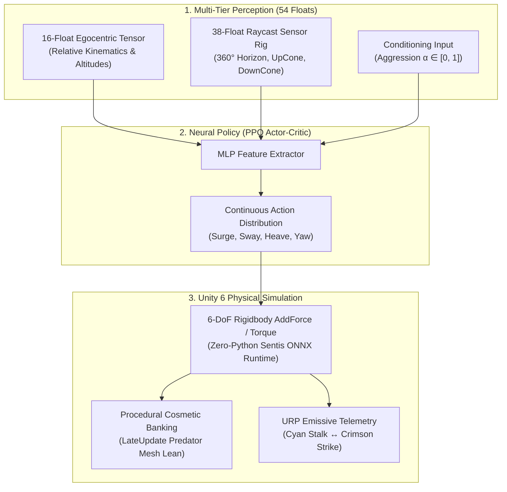

# GeistForge: 6-DoF Autonomous Combat Drone AI

[](https://unity.com/)
[](https://github.com/Unity-Technologies/ml-agents)
[-green.svg)](https://unity.com/products/sentis)
[]()
[]()


> A 6-DoF autonomous aerial combat agent trained via continuous Proximal Policy Optimization (PPO) across 11.5M cumulative simulation steps and deployed natively to Unity Sentis for sub-millisecond, zero-Python ONNX inference.

---

## System Architecture

GeistForge decouples physical flight translation (driven by the RL agent and physics solver) from procedural visual mesh banking, enabling high-impulse combat maneuvering without destabilizing orientation.



---

## Dual-Doctrine Behavioral Spectrum ($\alpha$)

The policy is conditioned on a continuous runtime parameter $\alpha \in [0.0, 1.0]$:

| Doctrine | Parametric Mode | Visual Telemetry | Target Behavior |
| :--- | :---: | :---: | :--- |
| **Tactical Stalking** | $\alpha = 0.0$ | **Cyan** | Maintains an elevated perch envelope ($3\,\text{m}$ offset, $+2\,\text{m}$ elevation), circle-strafes, and evades target intrusions. |
| **Parametric Blend** | $0 < \alpha < 1$ | **Interpolated** | Dynamic hybrid behavior; closes range while maintaining evasive lateral thruster readiness. |
| **Kamikaze Strike** | $\alpha = 1.0$ | **Crimson** | High-velocity terminal dive-bomb ($12\,\text{m/s}$) with vertical plunge commitment and obstacle traversal. |

---

## Mathematical Formulation

### 1. Multiplicative Planar Facing Gate ($G_{\text{face}}$)
To permanently eliminate the "Moonwalk Trap" (where the agent earns rewards while flying backward) without penalizing steep downward dive angles, the forward vector is projected onto the horizontal $XZ$ plane:

$$\hat{\mathbf{r}}_{XZ} = \frac{\mathbf{r}_{XZ}}{\|\mathbf{r}_{XZ}\|}, \quad \text{rawDot}_{XZ} = \mathbf{f} \cdot \hat{\mathbf{r}}_{XZ}$$

$$G_{\text{face}} = \begin{cases} (\text{rawDot}_{XZ})^2 & \text{if } \text{rawDot}_{XZ} > 0 \\ 0 & \text{otherwise} \end{cases}$$

Every positive reward term is multiplied by $G_{\text{face}}$, forcing the policy to keep the target within its forward cone.

### 2. Gaussian Perch Envelope ($R_{\text{perch}}$)
In Stalk mode ($\alpha = 0$), the agent is rewarded for maintaining a 3D tactical holding ring:

$$R_{\text{perch}} = G_{\text{face}} \cdot \exp\left( -\frac{(d_{XZ} - 3.0)^2}{2 \cdot (1.2)^2} - \frac{(\Delta y - 2.0)^2}{2 \cdot (1.0)^2} \right)$$

### 3. Personal-Space Breach & Quadratic Repulsion ($R_{\text{breach}}$)
When the target breaches the $2.0\,\text{m}$ tactical perimeter ($d_{XZ} < 2.0\,\text{m}$):

$$R_{\text{breach}} = -0.5 \left(\frac{2.0 - d_{XZ}}{2.0}\right)^2 + 0.6 \cdot G_{\text{face}} \cdot \text{clamp}\left(\frac{v_{\text{retreat}}}{v_{\text{max}}}, -1, 1\right)$$

### 4. 3D Strike Dynamic Closing & Linear Urgency Bleed ($R_{\text{strike}}$)
In Strike mode ($\alpha = 1$), static proximity rewards are removed to eliminate the **Loitering Trap**. The agent is rewarded strictly for closing velocity and downward vertical plunge:

$$v_{\text{close}} = (\mathbf{v}_{\text{drone}} - \mathbf{v}_{\text{target}}) \cdot \hat{\mathbf{r}}, \quad v_{\text{dive}} = \text{sgn}(\Delta y) \cdot v_{y,\text{rel}}$$

$$R_{\text{strike}} = G_{\text{face}} \left[ 0.8 \cdot \text{clamp}\left(\frac{v_{\text{close}}}{v_{\text{max}}}\right) + 0.4 \cdot \text{clamp}\left(\frac{v_{\text{dive}}}{v_{\text{max}}}\right) + R_{\text{magnet}} \right] - 0.35$$

### 5. Composite Step Reward
$$R_{\text{step}} = 0.01 \cdot \left[ (1 - \alpha) R_{\text{stalk}} + \alpha R_{\text{strike}} \right]$$

---

## Engineering Post-Mortem: Overcoming RL Failure Modes

| # | Phenomenon Encountered | Root Mathematical / Physical Cause | Production Resolution |
|---|---|---|---|
| **1** | **The "War Horn" Temporal Shortcut** | Flipping $\alpha: 0 \to 1$ mid-episode allowed Bellman backups ($V(s_t)$) to bootstrap terminal strike payouts during Stalk mode, turning Stalk into a passive waiting room. | **Episode-Static Stratified $\alpha$-Sampling** (40% pure Stalk, 30% pure Strike, 30% $U(0,1)$) during training while preserving frame-by-frame slider conditioning at runtime. |
| **2** | **Feature Collinearity (Floor Altimeter Shortcut)** | Fixed target elevation in early stages made floor distance (`obs[14]`) 100% collinear with target relative height at $4\times$ higher signal variance. | Clamped `obs[14]` to a **short-range floor-proximity warning** active only below $1.5\,\text{m}$ ($0.0$ in mid-air), forcing the MLP to wire heave ($a_2$) strictly to ego-relative target elevation. |
| **3** | **The 1.48m Geometric Stall & Pitch Dilution** | A 3D dot product on a horizon-locked Rigidbody penalized steep downward dives by $\cos^2(\phi_{\text{pitch}})$, while passive proximity rewards created a zero-velocity hovering equilibrium. | Projected $G_{\text{face}}$ onto the horizontal $XZ$ plane, replaced passive proximity with **3D + vertical closing velocity**, and added a $-0.35$ urgency bleed. |
| **4** | **The Collider Blockade (Physical Boundary Bug)** | Rigid physical contact occurred at $0.98\,\text{m}$ ($r_{\text{drone}} + r_{\text{target}}$), rendering the original $<0.80\,\text{m}$ strike condition physically unattainable without collider penetration. | Expanded terminal strike detonation threshold to $1.15\,\text{m}$, aligning reward verification with the continuous dynamic physics simulation. |

---

## Observation & Action Space Specification

### Observation Vector (54 Floats)
- **`[0..2]`**: Egocentric target position (normalized $/ 20\,\text{m}$)
- **`[3]`**: Normalized distance to target ($\| \mathbf{r} \| / 20\,\text{m}$)
- **`[4..6]`**: Egocentric unit direction to target
- **`[7..9]`**: Drone linear velocity in local space ($/ 12\,\text{m/s}$)
- **`[10..12]`**: Target relative velocity in local space ($/ 12\,\text{m/s}$)
- **`[13]`**: Normalized yaw angular rate ($\omega_y / \omega_{\text{max}}$)
- **`[14]`**: Short-range floor proximity warning ($\text{clamp01}((1.5 - d_{\text{floor}})/1.5)$)
- **`[15]`**: Conditioned Aggression parameter ($\alpha$)
- **`[16..53]`**: 38 RayPerceptionSensor3D inputs (Horizon 360°, Upper 45° Cone, Lower 45° Cone)

### Continuous Action Space (4 Continuous Floats)
- **$a_0$ Surge**: Longitudinal thrust $[-1.0, 1.0]$ ($0.85\times$ reverse scale)
- **$a_1$ Sway**: Lateral strafe thrust $[-1.0, 1.0]$
- **$a_2$ Heave**: Vertical lift thrust $[-1.0, 1.0]$
- **$a_3$ Yaw**: Rotational angular rate command $[-1.0, 1.0]$ (up to $380^\circ/\text{s}$)

---

## Quickstart & Inference in Unity Sentis

No Python environment or PyTorch installation is required to run the trained model in your scene.

1. Clone this repository:
   ```bash
   git clone https://github.com/jeepixd/GeistForge-Engine.git
   ```
2. Open the project in **Unity 6 (6000.0+)**.
3. Open either scene under `Assets/Drone/Scene/`:
   - `Testing Area.unity`: Dedicated single-agent showcase arena.
   - `TrainingArena.unity`: Parallel curriculum training environment.
4. Select the `Drone` GameObject in the hierarchy:
   - Verify `Behavior Parameters -> Model` is set to `KillerDrone_Stage3_CombatStress.onnx`.
   - Set `Behavior Type` to `Inference Only`.
5. Press **Play**:
   - Adjust the **`Aggression`** slider on `KillerDroneAgent` in real time to observe dynamic doctrine switching between Cyan Stalk and Crimson Strike.

---

## Tech Stack & Hardware

- **Engine**: Unity 6000.0 LTS (Universal Render Pipeline)
- **Inference Runtime**: Unity Sentis (ONNX Runtime)
- **Reinforcement Learning Framework**: Unity ML-Agents v0.30.0 / PyTorch 2.2
- **Training Acceleration**: CUDA-accelerated PPO on NVIDIA GeForce RTX 4060 Laptop GPU
- **Simulation Throughput**: $\approx 11.5\,\text{M}$ cumulative simulation steps across 4 curriculum phases

---

## License
Distributed under the MIT License. See `LICENSE` for more information.
