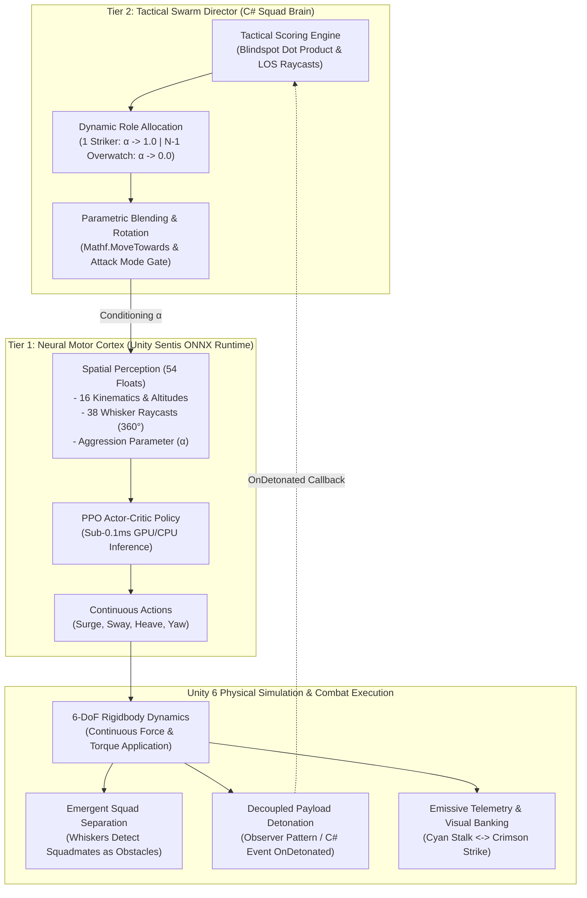

# GeistForge: Autonomous Aerial Combat Swarm AI

[](https://unity.com/)
[](https://github.com/Unity-Technologies/ml-agents)
[-green.svg)](https://unity.com/products/sentis)
[]()
[]()
[]()


> A 6-DoF autonomous aerial combat drone swarm trained via continuous Proximal Policy Optimization (PPO) across 11.5M cumulative simulation steps, coordinated by a decoupled two-tier Tactical Swarm Director ("Wolfpack Protocol"), and deployed natively to Unity Sentis for sub-0.1ms, zero-Python ONNX inference.

---

## Executive Overview

Traditional 3D aerial navigation in game engines relies on layered NavMesh slicing or predetermined spline rails. These techniques break down when agents must maneuver with genuine 6-DoF momentum, high-speed physical drag, dynamic obstacle fields, and multi-agent spatial coordination.

GeistForge solves this through a hybrid architecture:
1. **Tier 1 (Motor Cortex)**: An end-to-end continuous PPO neural network running in Unity Sentis, translating 54 spatial observations directly into 4 continuous motor thrusters at sub-0.1ms latency.
2. **Tier 2 (Tactical Swarm Director)**: A lightweight, decoupled C# squad coordinator that evaluates geometric line-of-sight and player blind-spot vectors to dynamically allocate Striker and Overwatch roles across the squad.
3. **Emergent Mutual Avoidance**: By registering each drone as an `Obstacle`, the existing 38-whisker raycast perception arrays naturally prevent clumping and squad collisions with zero multi-agent retraining.

---

## System Architecture



---

## Dual-Doctrine Behavioral Spectrum

Each drone's neural policy is conditioned on a continuous runtime scalar parameter $\alpha \in [0.0, 1.0]$, dynamically interpolated by the Swarm Director:

| Tactical Doctrine | State Parameter | Emissive Telemetry | Physical Behavior |
| :--- | :---: | :---: | :--- |
| **Tactical Stalking / Overwatch** | $\alpha = 0.0$ | **Cyan** | Maintains an elevated standoff envelope ($3\,\text{m}$ radius, $+2\,\text{m}$ elevation), executes evasive circle-strafing, and holds player blind-spot sectors. |
| **Parametric Blending** | $0.0 < \alpha < 1.0$ | **Interpolated** | Dynamic transition state; accelerates toward target while maintaining evasive lateral thruster responsiveness. |
| **Kamikaze Strike** | $\alpha = 1.0$ | **Crimson** | High-velocity terminal plunge ($12\,\text{m/s}$) with vertical commitment, aggressive pillar evasion, and proximity/impact payload detonation. |

---

## Mathematical Formulation

### 1. Swarm Director Tactical Priority Score ($S_{\text{tactical}}$)
The Swarm Director determines which drone launches the next assault using an egocentric blind-spot dot product and obstacle raycast verification:

$$\hat{\mathbf{d}}_{\text{toDrone}} = \frac{\mathbf{x}_{\text{drone}} - \mathbf{x}_{\text{player}}}{\|\mathbf{x}_{\text{drone}} - \mathbf{x}_{\text{player}}\|}$$

$$\text{FlankScore} = -\left( \mathbf{f}_{\text{player}} \cdot \hat{\mathbf{d}}_{\text{toDrone}} \right)$$

$$\text{LOSScore} = \begin{cases} +2.0 & \text{if Raycast}(\mathbf{x}_{\text{drone}}, -\hat{\mathbf{d}}, d, \text{Obstacles}) == \text{False} \\ -5.0 & \text{if Raycast} == \text{True} \end{cases}$$

$$S_{\text{tactical}} = (\text{FlankScore} \cdot w_{\text{blindspot}}) + \text{LOSScore} - (d \cdot w_{\text{dist}})$$

* **Flank Advantage**: Drones in the player's rear blind spot ($\mathbf{f}_{\text{player}} \cdot \hat{\mathbf{d}} \to -1.0$) receive a $+1.0$ priority bonus. Drones directly in the player's field of view take a $-1.0$ penalty.
* **Line of Sight**: Blocked trajectories through pillars apply a $-5.0$ penalty to prevent dive-bomb collisions into scene geometry.

### 2. Multiplicative Planar Facing Gate ($G_{\text{face}}$)
To permanently eliminate backward drift without penalizing steep downward attack vectors, the drone's forward vector is projected onto the horizontal $XZ$ plane:

$$\hat{\mathbf{r}}_{XZ} = \frac{\mathbf{r}_{XZ}}{\|\mathbf{r}_{XZ}\|}, \quad \text{rawDot}_{XZ} = \mathbf{f}_{\text{drone}} \cdot \hat{\mathbf{r}}_{XZ}$$

$$G_{\text{face}} = \begin{cases} (\text{rawDot}_{XZ})^2 & \text{if } \text{rawDot}_{XZ} > 0 \\ 0 & \text{otherwise} \end{cases}$$

### 3. Gaussian Perch Envelope ($R_{\text{perch}}$)
In Stalk mode ($\alpha = 0$), the agent is rewarded for holding an elevated standoff ring:

$$R_{\text{perch}} = G_{\text{face}} \cdot \exp\left( -\frac{(d_{XZ} - 3.0)^2}{2 \cdot (1.2)^2} - \frac{(\Delta y - 2.0)^2}{2 \cdot (1.0)^2} \right)$$

### 4. Dynamic Strike Velocity & Urgency Bleed ($R_{\text{strike}}$)
In Strike mode ($\alpha = 1$), static loitering incentives are eliminated. Reward is governed strictly by closing velocity, vertical plunge, and an urgency decay:

$$v_{\text{close}} = (\mathbf{v}_{\text{drone}} - \mathbf{v}_{\text{target}}) \cdot \hat{\mathbf{r}}, \quad v_{\text{dive}} = \text{sgn}(\Delta y) \cdot v_{y,\text{rel}}$$

$$R_{\text{strike}} = G_{\text{face}} \left[ 0.8 \cdot \text{clamp}\left(\frac{v_{\text{close}}}{v_{\text{max}}}\right) + 0.4 \cdot \text{clamp}\left(\frac{v_{\text{dive}}}{v_{\text{max}}}\right) + R_{\text{magnet}} \right] - 0.35$$

---

## Engineering Post-Mortem: Overcoming RL Failure Modes

| # | Encountered Failure Mode | Root Mathematical / Physical Cause | Production Resolution |
|---|---|---|---|
| **1** | **The "War Horn" Shortcut** | Toggling $\alpha: 0 \to 1$ mid-episode allowed Bellman value backups ($V(s_t)$) to bootstrap terminal strike rewards into Stalk mode, converting Stalking into a passive waiting state. | **Episode-Static Stratified $\alpha$-Sampling** (40% pure Stalk, 30% pure Strike, 30% uniform random) during training, while preserving smooth frame-by-frame runtime slider blending. |
| **2** | **Feature Collinearity (Altimeter Shortcut)** | Fixed target height across early curriculum phases made the downward altimeter (`obs[14]`) 100% collinear with target relative elevation, but at $4\times$ higher signal variance. | Clamped `obs[14]` to a **short-range ground warning** active only below $1.5\,\text{m}$ ($0.0$ at cruising height), forcing the network to correlate heave ($a_2$) strictly with target relative altitude. |
| **3** | **1.48m Geometric Stall & Pitch Dilution** | A 3D dot product applied to a horizontal-constrained Rigidbody penalized downward dives by $\cos^2(\phi_{\text{pitch}})$, while passive proximity rewards created zero-velocity hovering equilibria. | Projected $G_{\text{face}}$ onto the $XZ$ plane, replaced proximity rewards with **3D + vertical closing velocity**, and added a $-0.35$ urgency bleed. |
| **4** | **Multi-Agent Flocking Clumping** | Spawning multiple independent drones without coordination caused agents to cluster on identical pursuit trajectories and collide. | Tagged drone hulls as `Obstacle` to utilize their existing 38-whisker raycast nets for **emergent mutual separation**, governed by the C# Swarm Director. |

---

## Observation & Action Space Specification

### Observation Tensor (54 Continuous Floats)
- **`[0..2]`**: Egocentric target position (normalized $/ 20\,\text{m}$)
- **`[3]`**: Normalized Euclidean distance to target ($\| \mathbf{r} \| / 20\,\text{m}$)
- **`[4..6]`**: Egocentric unit direction vector to target
- **`[7..9]`**: Drone linear velocity in local body coordinates ($/ 12\,\text{m/s}$)
- **`[10..12]`**: Target relative linear velocity in local body coordinates ($/ 12\,\text{m/s}$)
- **`[13]`**: Normalized yaw angular rate ($\omega_y / \omega_{\text{max}}$)
- **`[14]`**: Short-range ground proximity warning ($\text{clamp01}((1.5 - d_{\text{floor}})/1.5)$)
- **`[15]`**: Conditioned Aggression scalar parameter ($\alpha$)
- **`[16..53]`**: 38 RayPerceptionSensor3D whiskers (360° Horizontal Plane, Upper 45° Cone, Lower 45° Cone)

### Action Space (4 Continuous Actuators)
- **$a_0$ Surge**: Longitudinal thrust command $[-1.0, 1.0]$ ($0.85\times$ reverse multiplier)
- **$a_1$ Sway**: Lateral strafe thrust command $[-1.0, 1.0]$
- **$a_2$ Heave**: Vertical lift thrust command $[-1.0, 1.0]$
- **$a_3$ Yaw Rate**: Rotational rate command $[-1.0, 1.0]$ (up to $380^\circ/\text{s}$)

---

## Quickstart & Sentis Deployment

No Python environment, PyTorch installation, or CUDA toolkit is required to run the trained model.

1. Clone the repository:
   ```bash
   git clone https://github.com/jeepixd/GeistForge-Engine.git
   ```
2. Open the project in **Unity 6 (6000.0+)**.
3. Open `Assets/Drone/Scene/Testing Area.unity`.
4. Inspect the `[SwarmDirector]` GameObject:
   - Set **`Attack Mode`** to `0` for passive squad loitering / overwatch.
   - Set **`Attack Mode`** to `1` to initiate tactical kamikaze strike rotations.
5. Press **Play**:
   - The swarm coordinates dynamically in real time. Overwatch drones loiter in Cyan; the elected Striker turns Crimson and dives with obstacle evasion.

---

## Tech Stack & Hardware Specifications

- **Simulation Engine**: Unity 6000.0 LTS (Universal Render Pipeline)
- **Inference Runtime**: Unity Sentis (Zero-Python ONNX Runtime)
- **Inference Latency**: Sub-0.1ms per agent on GPU/CPU
- **Reinforcement Learning Framework**: Unity ML-Agents v0.30.0 / PyTorch 2.2
- **Training Acceleration**: CUDA-accelerated PPO on NVIDIA GeForce RTX 4060 Laptop GPU
- **Simulation Throughput**: $\approx 11.5\,\text{M}$ cumulative training steps across 4 curriculum phases

---

## License

Distributed under the MIT License. See `LICENSE` for complete details.
